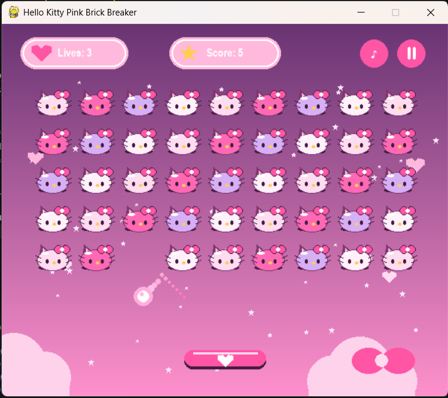

# Hello Kitty Pink Brick Breaker

## 1. Deskripsi Proyek

Hello Kitty Pink Brick Breaker merupakan modifikasi dari permainan
klasik **Brick Breaker** yang dibuat menggunakan Python dan Pygame. Pada
versi ini, tampilan permainan diubah menjadi tema pastel pink dan kawaii
dengan karakter Hello Kitty sebagai balok yang harus dihancurkan oleh
bola.

Pemain menggerakkan paddle di bagian bawah layar untuk memantulkan bola
ke arah balok. Setiap karakter Hello Kitty dihancurkan satu per satu
hingga seluruh balok habis.

## 2. Teknologi yang Digunakan

-   **Bahasa pemrograman:** Python
-   **Library permainan:** Pygame
-   **Library tambahan:** `random`, `math`, dan `sys` (library bawaan
    Python)
-   **Resolusi permainan:** 600 × 500 piksel
-   **Target frame rate:** 60 FPS

## 3. Daftar Modifikasi

### A. Perubahan Tema dan Tampilan

-   Mengubah tampilan standar Brick Breaker menjadi tema **Hello Kitty
    Pink**.
-   Menggunakan latar belakang gradasi ungu dan pink.
-   Menambahkan dekorasi bintang, hati, awan, dan pita.
-   Mengubah warna elemen permainan menjadi kombinasi pink, putih,
    lavender, ungu, dan kuning pastel.
-   Mengubah judul jendela menjadi **Hello Kitty Pink Brick Breaker**.

### B. Mengubah Balok Menjadi Karakter Hello Kitty

-   Mengganti balok persegi panjang biasa dengan ilustrasi wajah Hello
    Kitty.
-   Setiap balok digambar secara individual menggunakan fungsi gambar
    Pygame.
-   Setiap karakter memiliki telinga, wajah, mata, hidung, kumis, dan
    pita.
-   Menyusun karakter dalam pola baris dan kolom yang teratur.
-   Menggunakan variasi warna pastel agar susunan karakter terlihat
    lebih menarik.
-   Membuat setiap karakter dapat dihancurkan secara terpisah.

### C. Perubahan Bola

-   Mengubah tampilan bola menjadi putih dengan efek cahaya pink.
-   Menambahkan efek jejak atau **meteor trail** ketika bola bergerak.
-   Menambahkan efek glow untuk membuat bola lebih terlihat.
-   Mengatur posisi awal bola agar berada di atas paddle dan tidak
    terlalu dekat dengan barisan karakter.
-   Membuat bola menempel pada paddle sebelum permainan dimulai atau
    setelah pemain kehilangan satu nyawa.

### D. Perubahan Paddle

-   Mengubah paddle menjadi warna pink.
-   Membuat sudut paddle membulat.
-   Menambahkan garis highlight dan simbol hati di bagian tengah.
-   Mempertahankan fungsi gerakan ke kiri dan ke kanan menggunakan
    keyboard.

### E. Perubahan Sistem Tabrakan

-   Memperbaiki deteksi tabrakan antara bola dan karakter Hello Kitty.
-   Memproses satu balok yang bertabrakan pada satu waktu agar bola
    tidak langsung menghancurkan beberapa balok sekaligus.
-   Menentukan arah pantulan berdasarkan sisi balok yang terkena bola.
-   Memperbaiki posisi bola setelah tabrakan agar tidak tertahan atau
    menembus balok.
-   Menambahkan pemeriksaan tabrakan bola dengan paddle.

### F. Perubahan HUD dan Informasi Permainan

-   Mengubah tampilan informasi nyawa menjadi kapsul berwarna pink.
-   Mengubah tampilan skor menjadi kapsul dengan ikon bintang.
-   Menampilkan jumlah nyawa dan skor selama permainan berlangsung.
-   Mempertahankan sistem tiga nyawa.

### G. Penambahan Status Permainan

-   Menambahkan layar awal dengan instruksi untuk memulai permainan.
-   Menambahkan status **Pause** dan fitur melanjutkan permainan.
-   Menambahkan pesan **You Win!** ketika semua karakter berhasil
    dihancurkan.
-   Menambahkan pesan **Game Over** ketika seluruh nyawa habis.
-   Menambahkan fitur restart menggunakan tombol spasi.

## 4. Kontrol Permainan

  Tombol              Fungsi
  ------------------- --------------------------------------------
  Panah kiri (`←`)    Menggerakkan paddle ke kiri
  Panah kanan (`→`)   Menggerakkan paddle ke kanan
  `A`                 Menggerakkan paddle ke kiri
  `D`                 Menggerakkan paddle ke kanan
  `SPACE`             Memulai permainan atau mengulang permainan
  `P`                 Pause atau melanjutkan permainan
  `ESC`               Keluar dari permainan

## 5. Cara Menjalankan Program

Pastikan Python sudah terpasang pada komputer. Selanjutnya, buka
terminal pada folder proyek dan pastikan Pygame sudah tersedia.

Periksa instalasi Pygame:

``` bash
py -m pip show pygame
```

Jika belum terpasang, instal dengan:

``` bash
py -m pip install pygame
```

Jalankan permainan dengan perintah:

``` bash
py gamebrickbreaker.py
```

Jika nama file Python berbeda, sesuaikan perintah tersebut dengan nama
file yang digunakan.

## 6. Struktur File

Contoh struktur folder proyek:

``` text
ModifyGameBrickBreaker_079/
│
├── gamebrickbreaker.py
└── README.md
```

## 7. Kesimpulan

Modifikasi ini berfokus pada perubahan tampilan visual dan penyempurnaan
mekanisme permainan Brick Breaker. Perubahan paling utama adalah
mengganti balok standar menjadi karakter Hello Kitty individual,
menerapkan tema pink pastel, menambahkan efek meteor pada bola, serta
memperbaiki sistem tabrakan agar setiap karakter dihancurkan secara
terpisah. Modifikasi juga mempertahankan mekanisme inti permainan
seperti skor, nyawa, paddle, pantulan bola, pause, menang, dan game
over.

